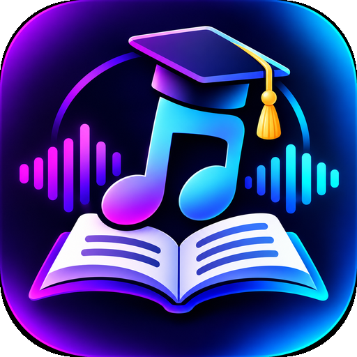

<p align="center">
  
</p>

<h1 align="center">LyricFlow</h1>

<p align="center">
  <b>Lis, comprends et mémorise les paroles de tes chansons préférées.</b><br/>
  Appli mobile Android & iOS — Flutter
</p>

<p align="center">
  <a href="../../actions/workflows/build.yml"></a>
  <a href="../../releases/latest"></a>
  
  
</p>

---

LyricFlow transforme l'écoute musicale en **apprentissage actif** : les paroles défilent au rythme exact de la musique, tu boucles les passages difficiles, tu traduis les chansons étrangères et tu t'entraînes jusqu'à connaître chaque ligne par cœur. Pour le chant, le karaoké ou l'apprentissage des langues.

## ✨ Fonctionnalités

| | Fonctionnalité | Détail |
|---|---|---|
| 🎵 | **Paroles synchronisées** | Recherche dans [LRCLIB](https://lrclib.net) (base libre et gratuite), import de fichiers `.lrc` ou paroles collées à la main |
| 🎧 | **Lecture sur ton audio** | Ajoute le fichier audio de la chanson : les paroles défilent en temps réel. Sans audio, un **mode chrono** fait défiler les paroles quand même |
| 🔁 | **Boucle et répétition** | Appui long sur une ligne → répéter la ligne, le passage, ou une boucle **A → B** personnalisée |
| 🐢 | **Vitesse réglable** | ×0,5, ×0,75, ×1, ×1,25 pour les passages rapides |
| 🎚️ | **Décalage des paroles** | Ajuste de ±0,2 s si les paroles sont en avance ou en retard |
| ✋ | **Synchronisation au tap** | Paroles non synchronisées ? Tape au début de chaque ligne pendant l'écoute, c'est enregistré |
| 🌍 | **Traduction** | Traduction ligne par ligne vers 11 langues (français, anglais, espagnol, portugais, allemand, italien, japonais, coréen, chinois, arabe, swahili) |
| 📝 | **Signification** | Ajoute tes notes sur une expression ou une ligne |
| 🧠 | **4 modes d'entraînement** | Flashcards (devine la ligne suivante), texte à trous, mémoire progressive (les mots disparaissent), remise en ordre des lignes |
| 📈 | **Suivi de progression** | Niveau de maîtrise de 0 à 5 par ligne, % par chanson, lignes maîtrisées, série de jours |
| 📚 | **Bibliothèque personnelle** | Favoris, filtres (en cours / maîtrisées), tout est stocké sur l'appareil |

Deux **chansons de démo originales** (anglais et français) sont incluses pour tout tester sans connexion.

## 📲 Installer

Chaque push sur `main` compile automatiquement l'appli et publie une version dans **[Releases](../../releases/latest)** :

- **Android** : télécharge `LyricFlow.apk` → ouvre-le → autorise l'installation depuis des sources inconnues.
- **iPhone** : `LyricFlow-unsigned.ipa` s'installe avec [AltStore](https://altstore.io) ou [Sideloadly](https://sideloadly.io) (pas de signature Apple).

## 🧭 Utilisation

1. **Rechercher** une chanson (« artiste titre »), ou **importer un .lrc**, ou **coller des paroles**.
2. Dans le lecteur, menu ⋮ → **Ajouter le fichier audio** (MP3, M4A, etc. déjà sur ton téléphone).
3. **Touche** une ligne pour y sauter ; **appui long** pour la boucler, l'annoter ou la marquer comme sue.
4. Bouton 🌐 pour afficher la **traduction**.
5. Bouton 🎓 pour **t'entraîner**.

## 🛠️ Développement

```bash
git clone https://github.com/ck526438-lgtm/lyricflow.git
cd lyricflow
flutter create --org com.lyricflow --project-name lyricflow --platforms=android,ios .
python3 tool/patch_platforms.py     # nom de l'appli, permissions Internet/audio
flutter pub get
dart run flutter_launcher_icons     # icône
flutter run
```

Tests : `flutter test`

### Architecture

```
lib/
├── main.dart                  Point d'entrée, thème, bibliothèque partagée
├── theme.dart                 Couleurs néon (violet → bleu → cyan) de l'icône
├── models/song.dart           Chanson, lignes horodatées, maîtrise, notes, traductions
├── data/demo_songs.dart       Chansons de démo originales
├── services/
│   ├── lrc_parser.dart        Lecture/écriture LRC, timeline (ligne active)
│   ├── lrclib_service.dart    API LRCLIB (recherche de paroles)
│   ├── translation_service.dart  API MyMemory (traduction ligne par ligne)
│   ├── playback.dart          Horloge de lecture : audio (just_audio) ou chrono, boucle A-B, vitesse
│   ├── practice_engine.dart   Génération des exercices
│   ├── library_store.dart     Bibliothèque + statistiques (shared_preferences)
│   ├── audio_files.dart       Import des fichiers audio
│   └── language.dart          Langues et détection automatique
├── screens/                   Accueil, Recherche, Bibliothèque, Lecteur, Synchro, Entraînement
└── widgets/common.dart        Barres sonores animées, anneau de progression…
```

## ⚖️ Droits d'auteur

LyricFlow **n'embarque aucune parole protégée**. Les paroles sont récupérées à la demande depuis LRCLIB, ou fournies par l'utilisateur, et restent sur son appareil. L'audio provient des fichiers personnels de l'utilisateur. Les chansons de démo ont été écrites spécialement pour l'appli.

## 🗺️ Feuille de route

- [ ] Reconnaissance vocale : vérifier que tu chantes les bonnes paroles
- [ ] Mode karaoké avec coloration mot par mot (LRC enrichi)
- [ ] Lecture via Spotify / Apple Music
- [ ] Synchronisation cloud et partage de playlists d'apprentissage

## 📄 Licence

MIT — © 2026 Christ ([@ck526438-lgtm](https://github.com/ck526438-lgtm))
